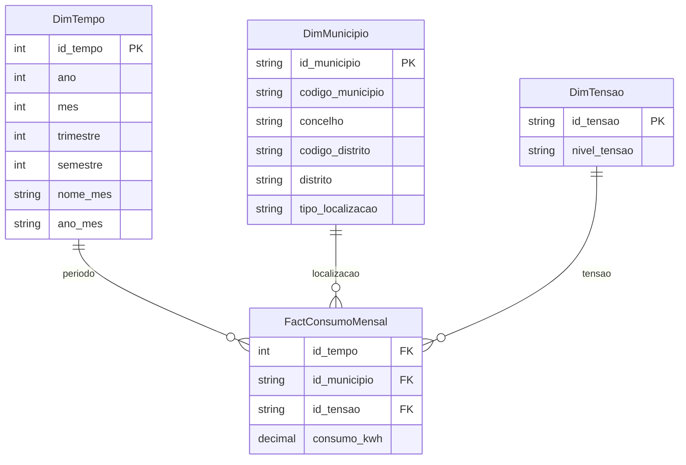

# Data Warehouse — modelo conceptual inicial

> **Proposta de modelação**, sujeita à validação dos dados reais e à discussão pelo grupo. Fonte de factos inicial: E-REDES.

## Granularidade

`FactConsumoMensal` contém uma linha por **mês × município (ou agregado RGPD separado) × nível de tensão**. A métrica `consumo_kwh` é aditiva entre municípios, períodos e categorias de tensão dentro desta fonte, desde que os membros RGPD sejam tratados corretamente.

## Regras

- Chaves dos códigos administrativos como texto (`0205`, não `205`).
- `tipo_localizacao`: `municipio`, `agregado_rgpd` ou `sem_codigo`.
- `OUTROS` é um membro agregado por distrito, não um município real. Filtrar `municipio` para rankings municipais; documentar se os totais distritais incluem os restantes registos.
- Preservar kWh negativos — não assumir que sejam dados errados sem investigar a fonte.
- Não ligar diretamente as tabelas de factos quando forem acrescentadas DGEG/PORDATA. Preferir dimensões conformadas (tempo e localização) e granularidade própria.
- Confirmar que as colunas `coddistritoconcelho` da E-REDES são compatíveis com códigos geográficos na DGEG/PORDATA (podem variar versões da divisão administrativa).

## Extensão futura — **ainda não desenvolvida**

- `FactConsumoSetorialAnual`: ano × município × setor de atividade (DGEG).
- `FactConsumoPorHabitanteAnual`: ano × município × indicador (PORDATA). **Rácio não aditivo**: não somar kWh/hab. entre municípios ou anos.

O âmbito é um projeto de BI e análise OLAP; a implementação PostgreSQL é opcional. O modelo semântico no Power BI pode funcionar como Data Warehouse analítico para a demonstração, desde que o grupo justifique a opção.
